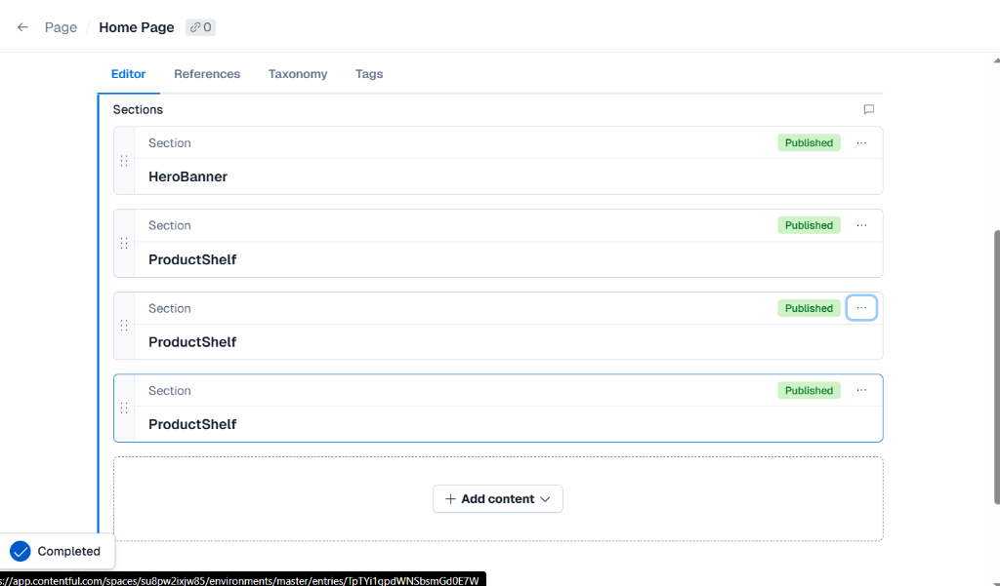
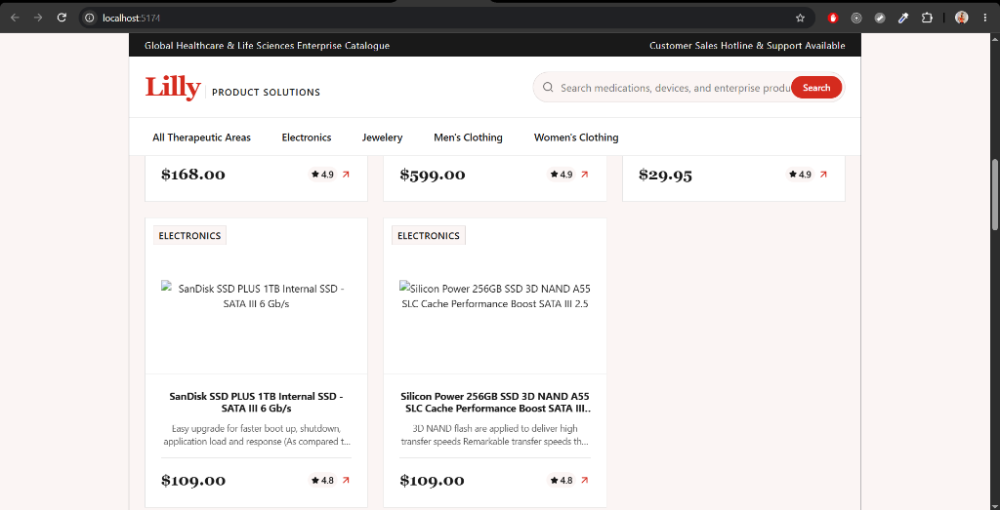
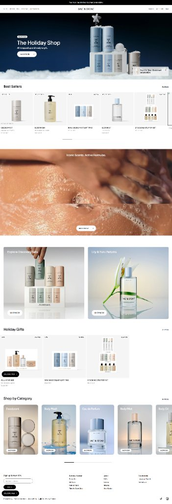

# Commercial Workstation Product Catalogue MVP

An enterprise-ready, extensible product catalogue application built for rapid evolution from MVP to production-scale eCommerce. Designed using clean architectural boundaries (Adapter/Repository pattern and Server-Driven UI) so that product data sources, CMS layout schemas, look-and-feel, and notification providers can evolve independently without frontend redeployment.

---

## 🌐 Live Deployment

The application is deployed live in production on AWS (Debian) with automated continuous deployment (CD) via Docker Hub and Watchtower:

- **Live Production URL**: [https://officework.mrsahni.tech/](https://officework.mrsahni.tech/)
- **Live API Health Check**: [https://officework.mrsahni.tech/health](https://officework.mrsahni.tech/health)
- **Live Deals & Offers**: [https://officework.mrsahni.tech/pages/deals](https://officework.mrsahni.tech/pages/deals)
- **Live Ergonomics Guide**: [https://officework.mrsahni.tech/pages/ergonomics](https://officework.mrsahni.tech/pages/ergonomics)
- **Live Corporate Enquiries**: [https://officework.mrsahni.tech/pages/contact](https://officework.mrsahni.tech/pages/contact)

---

## 📸 Application Preview

| Homepage (SDUI Dynamic Layout) | Product Detail & Specifications | Corporate Enquiry Modal |
| :---: | :---: | :---: |
|  |  |  |

---

## 🛠️ Tech Stack & Architectural Highlights

| Layer | Technology | Justification |
| :--- | :--- | :--- |
| **Frontend** | **React (JavaScript, Vite)** | Lightweight, fast HMR, componentized architecture. |
| **Styling** | **`styled-components`** | Token-driven design system, scoped styling, zero global CSS conflicts. |
| **Backend** | **Node.js (Express)** | Layered architecture (`controllers/`, `services/`, `adapters/`, `models/`), asynchronous non-blocking I/O. |
| **Product Data Source** | **Fake Store API + Product Adapter** | Wrapped in `ProductAdapter`. The frontend never queries external APIs directly (Constraint #2). |
| **Database** | **MongoDB Atlas / In-Memory Fallback** | Mongoose schema with automated fallback so reviewers do not need external accounts (Constraint #6). |
| **Notification** | **Notification Service Adapter** | Configurable for real SMTP (AWS SES / SendGrid) or automated console logging for zero-friction local testing. |
| **CMS / SDUI** | **Contentful Headless CMS + Adapter** | Server-Driven UI (SDUI) architecture allowing marketing & product teams to reorder page sections or launch campaigns without code redeploys. Includes zero-credential fallback mode for instant reviewer evaluation. |

---

## 📂 Project Structure

```
officeworks/
├── client/                     # React Single Page Application (Vite)
│   ├── public/                 # Static assets & favicon
│   ├── src/
│   │   ├── components/         # Atomic UI & layout components
│   │   │   ├── Navbar.jsx      # Dynamic responsive header & search bar
│   │   │   ├── Footer.jsx      # Dynamic responsive footer columns
│   │   │   ├── ProductCard.jsx # Bounded aspect-ratio product tile
│   │   │   ├── EnquiryModal.jsx# Validated B2B enquiry form & submission
│   │   │   └── library/        # Server-Driven UI (SDUI) component blocks
│   │   │       ├── ComponentRegistry.jsx # Dynamic CMS block mapper
│   │   │       ├── HeroBanner.jsx
│   │   │       ├── ProductShelf.jsx
│   │   │       ├── DualFeaturette.jsx
│   │   │       ├── CategoryPillsGrid.jsx
│   │   │       ├── ContactFormSection.jsx
│   │   │       └── ValuePropsStrip.jsx
│   │   ├── pages/              # Routed views
│   │   │   ├── HomePage.jsx    # CMS-driven dynamic homepage
│   │   │   ├── CategoryPage.jsx# Top-rated + additional category grid
│   │   │   ├── ProductDetailPage.jsx # Specifications & AFRDI certification
│   │   │   ├── SearchPage.jsx  # Case-insensitive search results
│   │   │   ├── DynamicPage.jsx # Catch-all CMS page renderer (/pages/:slug)
│   │   │   └── NotFoundPage.jsx
│   │   ├── services/
│   │   │   └── api.js          # Unified API client (Zero client third-party calls)
│   │   └── styles/
│   │       ├── GlobalStyle.js
│   │       └── theme.js        # Centralized design tokens
│   ├── Dockerfile              # Standalone Nginx production container
│   └── package.json
│
├── server/                     # Express.js REST API & Backend
│   ├── src/
│   │   ├── adapters/           # Decoupled external integrations
│   │   │   ├── product.adapter.js    # Fake Store API + offline workstation catalogue
│   │   │   └── contentful.adapter.js # Contentful CMS + fallback SDUI schemas
│   │   ├── controllers/        # Request/response handlers
│   │   │   ├── product.controller.js
│   │   │   ├── category.controller.js
│   │   │   ├── enquiry.controller.js
│   │   │   └── cms.controller.js
│   │   ├── routes/             # Express API route declarations
│   │   │   ├── products.routes.js
│   │   │   ├── categories.routes.js
│   │   │   ├── enquiries.routes.js
│   │   │   └── cms.routes.js
│   │   ├── services/
│   │   │   ├── product.service.js
│   │   │   ├── enquiry.service.js
│   │   │   └── notification.service.js # Sales inbox dispatcher (SMTP + console mock)
│   │   ├── models/             # Data schemas (Enquiry, Product)
│   │   ├── config/             # DB & environment loader
│   │   ├── app.js              # Express app definition & route binding
│   │   └── server.js           # Server entry point
│   ├── tests/
│   │   └── api.test.js         # Integration test suite (Supertest + Jest)
│   ├── Dockerfile              # Standalone Node.js container
│   └── package.json
│
├── .github/workflows/          # CI/CD Automated Pipelines
│   └── deploy.yml              # Multi-branch build & push to Docker Hub
├── docker-compose.yml          # Production multi-env composition + Watchtower CD
├── Dockerfile                  # Unified production multi-stage build
├── README.md                   # Setup guide & project overview
├── DECISIONS.md                # Assumptions, architectural rationale & roadmap
├── AI_USAGE.md                 # AI tooling, key prompts & error review log
└── AGENTS.md                   # Repository engineering rules & boundaries
```

---

## 🚀 Quick Start (Under 10 Minutes)

### Prerequisites
- **Node.js** (v18+ recommended) & **npm**
- Or **Docker** & **Docker Compose**

---

### Option 1: Run with Docker (Recommended - Single Command)

Ensure Docker Desktop is running, then run from the project root:

```bash
docker compose up --build
```

#### Exposed Local Ports:
- **Frontend Web Application (React UI)**: [http://localhost:80](http://localhost:80) (or [http://localhost](http://localhost))
- **Backend Express API**: [http://localhost:5000](http://localhost:5000)
- **API Health Check**: [http://localhost:5000/health](http://localhost:5000/health)

#### 🔄 Cloud Deployment (AWS / Debian with Auto-CD)
For remote cloud hosting, launch the entire multi-environment stack with a single command without cloning:

```bash
curl -fsSL https://raw.githubusercontent.com/tusharsahni22/officeworks/main/docker-compose.yml -o docker-compose.yml && docker compose up -d
```

Runs **Production** (`:80`), **QA** (`:8081`), and **Dev** (`:8082`) with Watchtower automatically deploying new GitHub commits every 60s. *(See [DECISIONS.md](DECISIONS.md#5-automated-continuous-deployment--multi-environment-architecture) for full CD architecture).*

---

### Option 2: Run Locally with Node.js & npm

#### 1. Setup Environment Files
From the project root:
```bash
# Server environment
cp server/.env.example server/.env
```
*(No external secrets or accounts are required; the app automatically runs in reviewer zero-dependency mode out of the box).*

#### 2. Start the Backend API
In terminal 1:
```bash
cd server
npm install
npm run dev
```
The server will start on [http://localhost:5000](http://localhost:5000).

#### 3. Start the Frontend Client
In terminal 2:
```bash
cd client
npm install
npm run dev
```
The frontend will start on [http://localhost:5173](http://localhost:5173) (or [http://localhost:5174](http://localhost:5174)).

---

## 🏗️ Building for Production

### Build the Frontend Client
```bash
cd client
npm run build
```
Compiled production assets are output to `client/dist/`.

### Run the Unified Production Server
The Express server is configured to serve the production build statically from a single container or server process:
```bash
cd server
npm start
```

---

## 🧪 Running Automated Tests

Run the backend integration test suite:

```bash
cd server
npm test
```

### Test Coverage Highlights (7/7 tests passing, 1 test suite):
- **Health Check**: `GET /health` returns 200 and operational status.
- **Top 5 Featured**: `GET /api/products/featured` returns exactly the 5 highest-rated products in descending order.
- **Search Filtering**: `GET /api/products?search=...` tests case-insensitive keyword search against title and description.
- **Product Lookup**: `GET /api/products/:id` validates single product specification payloads.
- **Category Listing**: `GET /api/categories` returns available commercial product categories.
- **Enquiry Validation**: `POST /api/enquiries` validates required fields, saves the enquiry, and returns 201 with "Thank you" confirmation.
- **Error Handling**: `POST /api/enquiries` with invalid email format correctly rejects with 400 Bad Request.

---

## 📱 Server-Driven UI & Dynamic Routes

The application incorporates a **Server-Driven UI (SDUI)** architecture backed by **Contentful Headless CMS**:
- **Homepage (`/`)**: Dynamically renders modular sections (`HeroBanner`, `ValuePropsStrip`, `ProductShelf`, `DualFeaturette`, `CategoryPillsGrid`) in the exact order configured in CMS.
- **Dynamic CMS Pages (`/pages/:slug`)**:
  - Live: [https://officework.mrsahni.tech/pages/deals](https://officework.mrsahni.tech/pages/deals) (Local: `http://localhost:5000/pages/deals`)
  - Live: [https://officework.mrsahni.tech/pages/ergonomics](https://officework.mrsahni.tech/pages/ergonomics) (Local: `http://localhost:5000/pages/ergonomics`)
  - Live: [https://officework.mrsahni.tech/pages/contact](https://officework.mrsahni.tech/pages/contact) (Local: `http://localhost:5000/pages/contact`)
- **Header & Footer**: Navigation links, announcements, and footer columns are fully CMS-driven.
- **Reviewer Fallback Mode**: If Contentful credentials are omitted from `.env`, the adapter automatically serves structured fallback layouts, guaranteeing zero setup friction.

---

## 📋 Acceptance Criteria Checklist

- [x] **Home Page (Top 5 Featured)**: Dynamically selects and renders the 5 highest-rated products.
- [x] **Category Page**: Displays top-rated products in that category, followed by additional category items.
- [x] **Search**: Case-insensitive keyword search against title, description, and category handled by backend API.
- [x] **Product Detail Page**: Displays high-res product imagery, rating, price, full specifications, and commercial warranty badges.
- [x] **Enquiry Submission**: "Enquire" button launches the enquiry modal, validates contact details, persists the record, and notifies the sales inbox while showing the customer a "Thank You" screen.
- [x] **Zero Paid Accounts / 10-Minute Setup**: Runs fully offline with in-memory persistence and console logging when external services (MongoDB/Contentful/SMTP) are not configured.

---

## 📁 Key Documentation Files

- [`DECISIONS.md`](DECISIONS.md): Architectural decisions, recorded assumptions, trade-offs, Watchtower CD details, and future roadmap.
- [`AI_USAGE.md`](AI_USAGE.md): AI tools used, key shaping prompts, reviewer error catches, and time-tracking breakdown.
- [`AGENTS.md`](AGENTS.md): Coding agent guidelines, architectural rules, and design constraints.
- [`.env.example`](.env.example): Root configuration template for Docker and backend environment variables.
